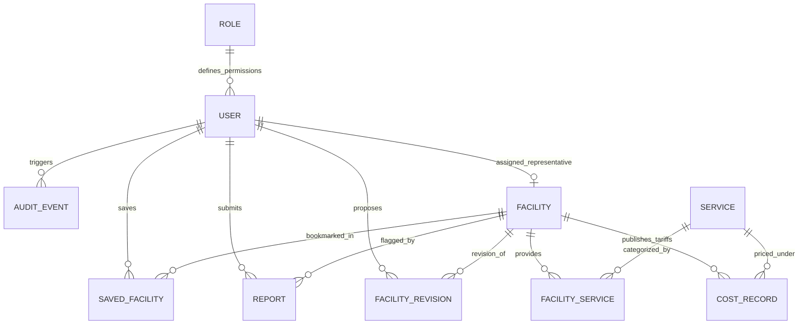

# MediGuide Relational Database Schema

MediGuide utilizes Prisma ORM with relational integrity, foreign key cascading, and database validations.

---

## 1. Entity-Relationship Diagram (ERD)

---

## 2. Table Specifications

### 2.1 `roles`
| Column | Type | Constraints | Description |
|---|---|---|---|
| `id` | INTEGER | PRIMARY KEY | Role identifier |
| `name` | VARCHAR | UNIQUE, NOT NULL | Role name (`GUEST`, `USER`, `FACILITY_REPRESENTATIVE`, `ADMIN`) |
| `description` | TEXT | NULLABLE | Detailed role privileges description |

### 2.2 `users`
| Column | Type | Constraints | Description |
|---|---|---|---|
| `user_id` | INTEGER | PRIMARY KEY | User identifier |
| `name` | VARCHAR | NOT NULL | User full name |
| `email` | VARCHAR | UNIQUE, NOT NULL | Login email address |
| `phone` | VARCHAR | NULLABLE | Contact telephone |
| `password_hash` | VARCHAR | NOT NULL | Bcrypt salted hash (Cost factor: 10) |
| `role_id` | INTEGER | FOREIGN KEY -> `roles(id)` | Current active role |
| `status` | VARCHAR | DEFAULT 'ACTIVE' | Status: `ACTIVE`, `PENDING`, `SUSPENDED` |
| `assigned_facility_id` | INTEGER | FOREIGN KEY -> `facilities(facility_id)` | Nullable organization pointer for reps |
| `created_at` | DATETIME | DEFAULT now() | Creation timestamp |
| `updated_at` | DATETIME | AUTO-UPDATE | Modification timestamp |

### 2.3 `facilities`
| Column | Type | Constraints | Description |
|---|---|---|---|
| `facility_id` | INTEGER | PRIMARY KEY | Unique facility identifier |
| `facility_name` | VARCHAR | NOT NULL | Facility display name |
| `facility_type` | VARCHAR | NOT NULL | `HOSPITAL`, `CLINIC`, `PHARMACY`, `DIAGNOSTIC_CENTRE`, `BLOOD_CENTRE`, `LABORATORY`, `OTHER` |
| `address` | TEXT | NOT NULL | Street address |
| `city` | VARCHAR | NOT NULL | City |
| `state` | VARCHAR | NOT NULL | State / Province |
| `pincode` | VARCHAR | NOT NULL | Postal code |
| `latitude` | FLOAT | NOT NULL | Geographic latitude |
| `longitude` | FLOAT | NOT NULL | Geographic longitude |
| `phone` | VARCHAR | NOT NULL | Emergency / general contact |
| `email` | VARCHAR | NULLABLE | Official email |
| `operating_hours` | VARCHAR | NOT NULL | Operating schedule description |
| `status` | VARCHAR | DEFAULT 'PENDING' | Status: `PENDING`, `VERIFIED`, `REJECTED`, `ARCHIVED` |
| `verified_at` | DATETIME | NULLABLE | Timestamp of admin verification |
| `verified_by` | INTEGER | NULLABLE | Admin user ID who reviewed listing |
| `created_at` | DATETIME | DEFAULT now() | Facility creation timestamp |
| `updated_at` | DATETIME | AUTO-UPDATE | Facility update timestamp |

### 2.4 `services`
| Column | Type | Constraints | Description |
|---|---|---|---|
| `service_id` | INTEGER | PRIMARY KEY | Unique service identifier |
| `name` | VARCHAR | UNIQUE, NOT NULL | Standardized name (e.g. General Consultation, MRI, CBC) |
| `category` | VARCHAR | NOT NULL | Clinical category (Consultations, Laboratory, Radiology, etc.) |
| `description` | TEXT | NULLABLE | Procedure details and patient instructions |
| `created_at` | DATETIME | DEFAULT now() | Creation timestamp |

### 2.5 `facility_services` (Junction Table)
| Column | Type | Constraints | Description |
|---|---|---|---|
| `facility_service_id`| INTEGER | PRIMARY KEY | Junction identifier |
| `facility_id` | INTEGER | FOREIGN KEY -> `facilities(facility_id)` | Facility link |
| `service_id` | INTEGER | FOREIGN KEY -> `services(service_id)` | Service link |
| `is_available` | BOOLEAN | DEFAULT true | Active availability flag |
| *Composite Unique* | `[facility_id, service_id]` | UNIQUE | Prevents duplicate service assignments |

### 2.6 `cost_records`
| Column | Type | Constraints | Description |
|---|---|---|---|
| `cost_id` | INTEGER | PRIMARY KEY | Cost record identifier |
| `facility_id` | INTEGER | FOREIGN KEY -> `facilities(facility_id)` | Facility link |
| `service_id` | INTEGER | FOREIGN KEY -> `services(service_id)` | Service link |
| `amount_min` | FLOAT | NOT NULL | Minimum approximate cost (₹) |
| `amount_max` | FLOAT | NOT NULL | Maximum approximate cost (₹) |
| `currency` | VARCHAR | DEFAULT 'INR' | Currency code |
| `unit_basis` | VARCHAR | NOT NULL | e.g. "per consultation", "per scan", "per test" |
| `source` | VARCHAR | NOT NULL | Data origin (Tariff Schedule, Rep Submission) |
| `verification_status`| VARCHAR | DEFAULT 'PENDING' | Status: `PENDING`, `VERIFIED`, `REJECTED` |
| `verified_at` | DATETIME | NULLABLE | Timestamp of verification |
| `verified_by` | INTEGER | NULLABLE | Admin ID who verified pricing |
| `collected_date` | DATETIME | DEFAULT now() | Date tariff was recorded |

### 2.7 `saved_facilities`
| Column | Type | Constraints | Description |
|---|---|---|---|
| `saved_id` | INTEGER | PRIMARY KEY | Bookmark record identifier |
| `user_id` | INTEGER | FOREIGN KEY -> `users(user_id)` | Patient user ID |
| `facility_id` | INTEGER | FOREIGN KEY -> `facilities(facility_id)` | Bookmarked facility |
| `created_at` | DATETIME | DEFAULT now() | Bookmark date |
| *Composite Unique* | `[user_id, facility_id]` | UNIQUE | Prevents duplicate saves |

### 2.8 `reports`
| Column | Type | Constraints | Description |
|---|---|---|---|
| `report_id` | INTEGER | PRIMARY KEY | Report ticket identifier |
| `facility_id` | INTEGER | FOREIGN KEY -> `facilities(facility_id)` | Target facility |
| `user_id` | INTEGER | FOREIGN KEY -> `users(user_id)` | Reporter account |
| `category` | VARCHAR | NOT NULL | `INCORRECT_ADDRESS`, `INCORRECT_PHONE`, `INCORRECT_HOURS`, etc. |
| `description` | TEXT | NOT NULL | Detailed user feedback |
| `status` | VARCHAR | DEFAULT 'OPEN' | `OPEN`, `UNDER_REVIEW`, `RESOLVED`, `REJECTED` |
| `admin_notes` | TEXT | NULLABLE | Resolution notes recorded by admin |
| `created_at` | DATETIME | DEFAULT now() | Submission date |

### 2.9 `facility_revisions`
| Column | Type | Constraints | Description |
|---|---|---|---|
| `revision_id` | INTEGER | PRIMARY KEY | Revision ticket ID |
| `facility_id` | INTEGER | FOREIGN KEY -> `facilities(facility_id)` | Target facility |
| `submitted_by` | INTEGER | FOREIGN KEY -> `users(user_id)` | Submitting representative ID |
| `proposed_data`| TEXT (JSON)| NOT NULL | JSON string with proposed field changes |
| `existing_data`| TEXT (JSON)| NOT NULL | JSON string snapshot of original facility state |
| `status` | VARCHAR | DEFAULT 'PENDING' | `PENDING`, `APPROVED`, `REJECTED`, `CORRECTION_REQUESTED` |
| `reviewed_by` | INTEGER | NULLABLE | Reviewing administrator ID |
| `review_notes` | TEXT | NULLABLE | Admin notes |

### 2.10 `audit_events`
| Column | Type | Constraints | Description |
|---|---|---|---|
| `audit_id` | INTEGER | PRIMARY KEY | Audit event record identifier |
| `user_id` | INTEGER | NULLABLE, FK -> `users(user_id)` | Actor user ID |
| `action` | VARCHAR | NOT NULL | `USER_LOGIN`, `FACILITY_VERIFY`, `COST_SUBMIT`, etc. |
| `entity` | VARCHAR | NOT NULL | Target entity type (`Facility`, `CostRecord`, etc.) |
| `entity_id` | VARCHAR | NOT NULL | Target record ID |
| `metadata` | TEXT (JSON)| NULLABLE | Event payload / change snapshot |
| `timestamp` | DATETIME | DEFAULT now() | Immutable timestamp |
